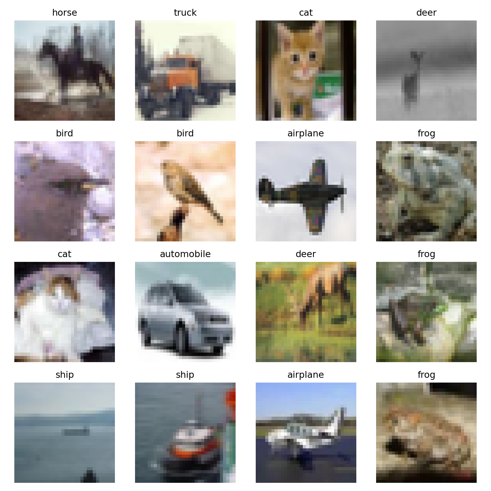
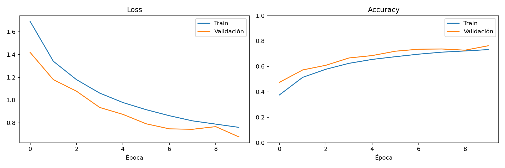
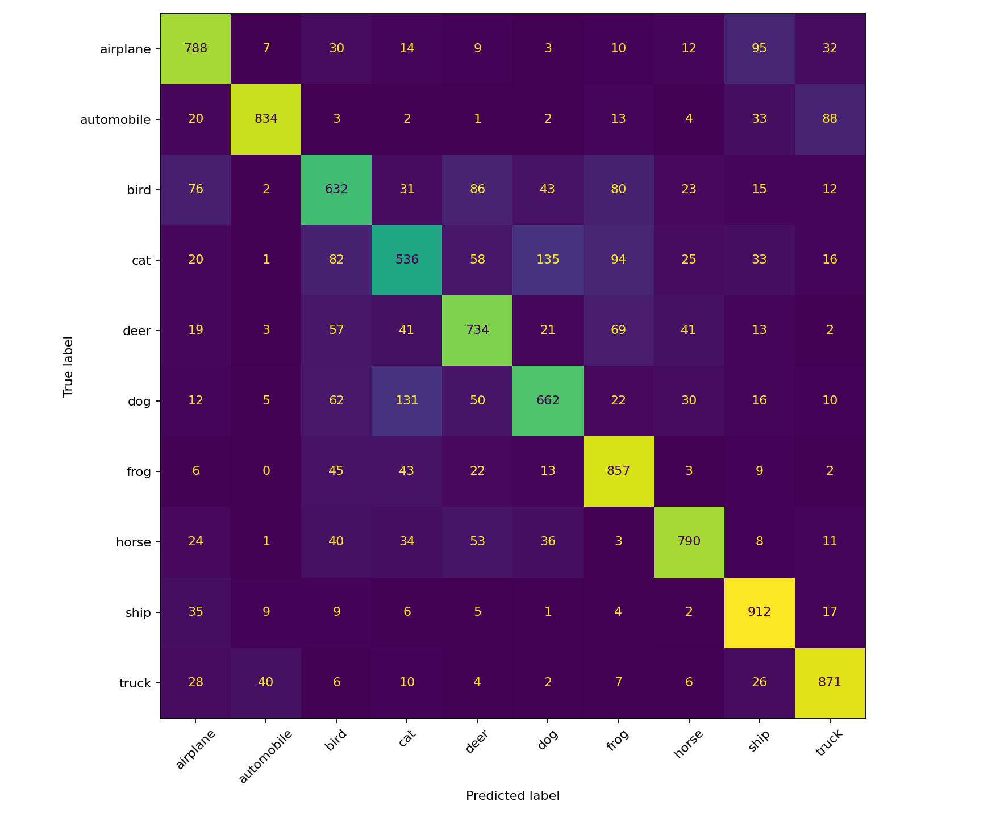

# EVALUACIÓN DE LA SEGUNDA UNIDAD – INTELIGENCIA ARTIFICIAL

## Clasificación de imágenes mediante CNN, flujo de tensores 4D y análisis de métricas

**Universidad:** Universidad Andina del Cusco  
**Escuela Profesional:** Ingeniería de Sistemas  
**Asignatura:** Inteligencia Artificial  
**Estudiante:** Hamlet Nayeli Delgado Ccorihuaman  
**Código de matrícula:** 020201359C  
**Semilla utilizada:** 59 (dos últimos dígitos numéricos; pendiente de confirmación por la letra final C)  
**Dataset:** CIFAR-10  
**Lenguaje de programación:** Python  
**Framework:** PyTorch  
**Entorno de desarrollo:** Google Colab y Visual Studio Code  

---

# 1. DESCRIPCIÓN GENERAL DEL PROYECTO

El presente proyecto desarrolla un sistema de clasificación automática de imágenes mediante una Red Neuronal Convolucional (CNN), utilizando el dataset CIFAR-10 y el framework PyTorch.

El propósito es implementar un flujo completo de aprendizaje profundo que comprenda la carga y preparación de datos, el diseño de una arquitectura convolucional, la manipulación de tensores cuatridimensionales, el entrenamiento del modelo y la evaluación de su capacidad de generalización.

El desarrollo se encuentra organizado en cuatro componentes principales, correspondientes a las preguntas de la evaluación de la segunda unidad.

## 1.1. Objetivo general

Implementar y evaluar una red neuronal convolucional para clasificar imágenes del dataset CIFAR-10, utilizando técnicas de preprocesamiento, aumento de datos, partición estratificada y evaluación mediante métricas de rendimiento.

## 1.2. Objetivos específicos

1. Cargar y explorar el dataset CIFAR-10 mediante herramientas de visión por computador.
2. Aplicar transformaciones y técnicas de aumento de datos para mejorar la capacidad de generalización del modelo.
3. Implementar una partición estratificada utilizando una semilla individual.
4. Diseñar una arquitectura CNN adecuada para imágenes RGB.
5. Verificar el flujo de tensores 4D a través de las capas convolucionales.
6. Entrenar el modelo mediante CrossEntropyLoss y el optimizador Adam.
7. Evaluar el rendimiento mediante accuracy, loss y matriz de confusión.
8. Analizar posibles síntomas de overfitting o underfitting.

---

# 2. DATASET UTILIZADO: CIFAR-10

CIFAR-10 es un conjunto de datos ampliamente utilizado para desarrollar y evaluar modelos de clasificación de imágenes.

Contiene 60 000 imágenes RGB de 32 × 32 píxeles, distribuidas en diez categorías.

## 2.1. Características del dataset

| Característica | Descripción |
|---|---|
| Dataset | CIFAR-10 |
| Total de imágenes | 60 000 |
| Imágenes de entrenamiento originales | 50 000 |
| Imágenes de prueba | 10 000 |
| Resolución | 32 × 32 píxeles |
| Canales | 3 (RGB) |
| Número de clases | 10 |
| Formato de tensores | NCHW |

## 2.2. Clases del dataset

Las diez categorías son:

1. Avión (Airplane)
2. Automóvil (Automobile)
3. Pájaro (Bird)
4. Gato (Cat)
5. Ciervo (Deer)
6. Perro (Dog)
7. Rana (Frog)
8. Caballo (Horse)
9. Barco (Ship)
10. Camión (Truck)

## 2.3. Distribución de los datos

Se implementó una partición estratificada del conjunto original de entrenamiento, utilizando el 80 % para entrenamiento y el 20 % para validación.

| Conjunto | Cantidad de imágenes | Porcentaje del total |
|---|---:|---:|
| Entrenamiento | 40 000 | 66,67 % |
| Validación | 10 000 | 16,67 % |
| Prueba | 10 000 | 16,67 % |
| **Total** | **60 000** | **100 %** |

La partición estratificada permite conservar la proporción de las clases originales en los conjuntos de entrenamiento y validación.

El conjunto oficial de prueba permanece independiente y se utiliza únicamente para la evaluación final.

---

# 3. PREGUNTA 1: CARGA, VISUALIZACIÓN, TRANSFORMACIONES Y PARTICIÓN

## 3.1. Configuración de la semilla

Para controlar la aleatoriedad del experimento, se utilizó la semilla individual 59, obtenida de los dos últimos dígitos numéricos del código de matrícula 020201359C.

La configuración se implementó mediante:

```python
import random
import numpy as np
import torch

SEED = 59

random.seed(SEED)
np.random.seed(SEED)
torch.manual_seed(SEED)

if torch.cuda.is_available():
    torch.cuda.manual_seed_all(SEED)
```

Esta configuración permite controlar la inicialización aleatoria de los pesos, la selección de muestras y otros procesos estocásticos.

Sin embargo, la reproducibilidad exacta también depende del hardware, las versiones de las librerías y las operaciones utilizadas.

## 3.2. Carga de CIFAR-10

El dataset se obtiene mediante la biblioteca `torchvision.datasets`, que proporciona acceso a conjuntos de datos estándar de visión por computador.

La carga se encuentra implementada en:

`src/dataset.py`

## 3.3. Visualización exploratoria

Se implementó una visualización de 16 imágenes seleccionadas del conjunto de datos, mostrando sus etiquetas reales.

Esta exploración permite identificar visualmente las características generales de las categorías y comprobar la correcta asociación entre las imágenes y sus clases.

### Muestras del dataset



## 3.4. Transformaciones aplicadas

Se utilizó un pipeline de transformaciones mediante `torchvision.transforms`.

### Transformaciones de entrenamiento

- `RandomCrop(32, padding=4)`: realiza recortes aleatorios para generar variaciones espaciales.
- `RandomHorizontalFlip(p=0.5)`: aplica inversiones horizontales aleatorias.
- `ToTensor()`: convierte las imágenes en tensores de PyTorch.
- `Normalize()`: normaliza los valores de los canales RGB.

### Transformaciones de validación y prueba

Se aplicaron únicamente:

- Conversión a tensor.
- Normalización RGB.

No se aplicaron aumentos aleatorios durante la validación ni durante la prueba.

Esta separación permite evaluar el modelo sobre imágenes sin alteraciones aleatorias adicionales.

## 3.5. Partición estratificada

Se utilizó una partición estratificada con la semilla 59.

El conjunto de entrenamiento original se dividió en:

- 40 000 imágenes para entrenamiento.
- 10 000 imágenes para validación.

Las 10 000 imágenes oficiales de prueba se conservaron de forma independiente.

Esta estrategia permite evaluar el aprendizaje del modelo sin utilizar las imágenes de prueba para actualizar sus parámetros.

---

# 4. PREGUNTA 2: JUSTIFICACIÓN DE CNN FRENTE A MLP

## 4.1. Limitaciones de un perceptrón multicapa

Un Perceptrón Multicapa (MLP) es una arquitectura neuronal formada principalmente por capas totalmente conectadas.

Para procesar una imagen CIFAR-10, un MLP convencional requiere transformar la matriz tridimensional de píxeles en un vector unidimensional.

Cada imagen contiene:

32 × 32 × 3 = 3072 valores.

Al realizar este aplanamiento, el modelo deja de representar explícitamente las relaciones espaciales entre los píxeles.

Además, una capa totalmente conectada de 3072 entradas y 1024 neuronas requiere:

3072 × 1024 + 1024 = 3 146 752 parámetros.

Esta cantidad corresponde únicamente a la primera capa densa.

Por lo tanto, una arquitectura MLP puede presentar un elevado costo computacional y una mayor dificultad para aprovechar eficientemente los patrones espaciales de las imágenes.

## 4.2. Ventajas de las redes neuronales convolucionales

Las Redes Neuronales Convolucionales (CNN) están diseñadas para procesar información con estructura espacial.

Sus principales ventajas son:

### Conectividad local

Las neuronas convolucionales procesan regiones específicas de la imagen mediante filtros de tamaño reducido.

Esto permite identificar características como bordes, texturas y formas.

### Compartición de pesos (Weight Sharing)

Un mismo filtro convolucional utiliza los mismos parámetros en diferentes posiciones de la imagen.

Esta propiedad reduce considerablemente la cantidad de parámetros necesarios.

### Equivarianza espacial

Las operaciones convolucionales permiten que los mapas de características respondan a patrones similares presentes en distintas posiciones.

La combinación de convoluciones, pooling y aumento de datos puede aportar cierta robustez frente a desplazamientos y transformaciones.

### Extracción jerárquica de características

Las primeras capas identifican características simples, mientras que las capas posteriores pueden combinar dichas características para representar patrones más complejos.

## 4.3. Comparación CNN frente a MLP

| Característica | MLP | CNN |
|---|---|---|
| Procesamiento de imágenes | Mediante vectores aplanados | Mediante filtros convolucionales |
| Estructura espacial | No se conserva explícitamente | Se aprovecha directamente |
| Compartición de pesos | No | Sí |
| Conexiones locales | No en capas densas convencionales | Sí |
| Cantidad de parámetros | Puede ser elevada | Generalmente más eficiente para imágenes |
| Extracción de características | Aprendizaje global mediante capas densas | Aprendizaje jerárquico de características espaciales |

En consecuencia, se seleccionó una arquitectura CNN por su capacidad para aprovechar la organización espacial de las imágenes CIFAR-10 y reducir la complejidad del procesamiento respecto a una arquitectura totalmente conectada convencional.

---

# 5. ARQUITECTURA DE LA RED NEURONAL CONVOLUCIONAL

Se diseñó una CNN compuesta por tres bloques convolucionales y dos capas densamente conectadas.

Cada bloque convolucional incluye:

- Conv2d.
- ReLU.
- MaxPool2d.

## 5.1. Especificación de capas

| Etapa | Operación | Tensor de salida |
|---|---|---|
| Entrada | Imagen RGB | (8, 3, 32, 32) |
| Bloque 1 | Conv2d(3,32,3,padding=1), ReLU, MaxPool2d(2) | (8, 32, 16, 16) |
| Bloque 2 | Conv2d(32,64,3,padding=1), ReLU, MaxPool2d(2) | (8, 64, 8, 8) |
| Bloque 3 | Conv2d(64,128,3,padding=1), ReLU, MaxPool2d(2) | (8, 128, 4, 4) |
| Aplanado | Flatten | (8, 2048) |
| Capa densa | Linear(2048,256), ReLU, Dropout(0.3) | (8, 256) |
| Salida | Linear(256,10) | (8, 10) |

## 5.2. Justificación de la arquitectura

Los bloques convolucionales permiten aumentar progresivamente la cantidad de mapas de características.

Las operaciones MaxPool2d reducen las dimensiones espaciales de los tensores.

La operación Flatten convierte la salida convolucional en un vector compatible con las capas densas.

La capa Dropout introduce regularización durante el entrenamiento, desactivando aleatoriamente una proporción de las activaciones.

Finalmente, la última capa Linear genera diez valores de salida, correspondientes a las diez categorías de CIFAR-10.

---

# 6. PREGUNTA 3: MANIPULACIÓN DE TENSORES 4D

## 6.1. Estructura de los tensores

Las redes neuronales convolucionales de PyTorch procesan imágenes mediante tensores de cuatro dimensiones.

Su estructura es:

**(Batch Size, Channels, Height, Width)**

Donde:

- Batch Size: cantidad de imágenes procesadas simultáneamente.
- Channels: cantidad de canales de la imagen o mapas de características.
- Height: altura.
- Width: anchura.

## 6.2. Validación del Forward Pass

Se utilizó un lote simulado de ocho imágenes RGB con dimensiones de 32 × 32 píxeles.

El tensor inicial presenta la forma:

```text
torch.Size([8, 3, 32, 32])
```

Durante el procesamiento se obtienen las siguientes dimensiones esperadas:

```text
Entrada:   torch.Size([8, 3, 32, 32])

Bloque 1:  torch.Size([8, 32, 16, 16])

Bloque 2:  torch.Size([8, 64, 8, 8])

Bloque 3:  torch.Size([8, 128, 4, 4])

Flatten:   torch.Size([8, 2048])

Salida:    torch.Size([8, 10])
```

## 6.3. Cálculo de la dimensión de aplanado

Después del tercer bloque convolucional, cada imagen presenta 128 mapas de características de tamaño 4 × 4.

Por lo tanto:

128 × 4 × 4 = 2048.

Este resultado determina el número de entradas de la primera capa totalmente conectada.

## 6.4. Validación mediante aserción

Se implementó una prueba utilizando:

```python
assert output.shape == (8, 10)
```

La aserción permite comprobar que la salida del modelo tenga las dimensiones esperadas.

La implementación se encuentra en:

`src/model.py`

---

# 7. PREGUNTA 4: ENTRENAMIENTO Y EVALUACIÓN

## 7.1. Configuración del entrenamiento

Se establecieron los siguientes hiperparámetros:

| Hiperparámetro | Valor |
|---|---|
| Modelo | CNN |
| Dataset | CIFAR-10 |
| Semilla | 59 |
| Épocas | 10 |
| Batch Size | 64 |
| Learning Rate | 0.001 |
| Función de pérdida | CrossEntropyLoss |
| Optimizador | Adam |
| Conjunto de entrenamiento | 40 000 imágenes |
| Conjunto de validación | 10 000 imágenes |
| Conjunto de prueba | 10 000 imágenes |

## 7.2. Función de pérdida

Se utilizó CrossEntropyLoss para medir la diferencia entre las predicciones del modelo y las etiquetas reales.

Esta función es adecuada para problemas de clasificación multiclase.

Durante el entrenamiento, el objetivo es minimizar la pérdida mediante la actualización de los parámetros de la red neuronal.

## 7.3. Optimizador Adam

Se utilizó Adam como algoritmo de optimización.

Adam ajusta los parámetros del modelo mediante estimaciones adaptativas basadas en los gradientes.

El optimizador permite actualizar los pesos de la CNN durante el proceso de retropropagación.

## 7.4. Ciclo de entrenamiento

El entrenamiento se implementó mediante un bucle iterativo de diez épocas.

Durante cada época se realizaron las siguientes operaciones:

1. Carga de lotes de imágenes.
2. Propagación hacia adelante (Forward Pass).
3. Cálculo de la pérdida.
4. Cálculo de gradientes mediante Backpropagation.
5. Actualización de pesos mediante Adam.
6. Cálculo de accuracy y loss de entrenamiento.
7. Evaluación del modelo con el conjunto de validación.
8. Registro de métricas.

El código correspondiente se encuentra en:

`src/train.py`
# 8. RESULTADOS DEL ENTRENAMIENTO

El modelo CNN fue entrenado durante 10 épocas utilizando el dataset CIFAR-10 y la semilla individual 59.

Durante el proceso se registraron las métricas de pérdida (Loss) y exactitud (Accuracy) correspondientes a los conjuntos de entrenamiento y validación.

Posteriormente, se realizó la evaluación final sobre el conjunto independiente de prueba.

## 8.1. Métricas finales de rendimiento

| Métrica | Resultado |
|---|---:|
| Semilla utilizada | 59 |
| Número de épocas | 10 |
| Accuracy de entrenamiento | 73,29 % |
| Accuracy de validación | 76,32 % |
| Accuracy de prueba | 76,16 % |
| Loss de entrenamiento | 0,7605 |
| Loss de validación | 0,6768 |
| Loss de prueba | 0,6906 |

Los resultados muestran que la CNN alcanzó una exactitud del **76,16 % sobre el conjunto de prueba**, lo que representa 7 616 imágenes correctamente clasificadas de un total de 10 000.

La diferencia entre la exactitud de validación y prueba fue de apenas 0,16 puntos porcentuales, lo cual indica un comportamiento similar del modelo en ambos conjuntos de evaluación.

## 8.2. Evolución del entrenamiento

La siguiente tabla presenta las métricas registradas durante las diez épocas.

| Época | Train Loss | Val Loss | Train Accuracy | Val Accuracy |
|---|---:|---:|---:|---:|
| 1 | 1,6906 | 1,4185 | 37,64 % | 47,51 % |
| 2 | 1,3410 | 1,1797 | 51,44 % | 57,27 % |
| 3 | 1,1793 | 1,0778 | 57,82 % | 60,95 % |
| 4 | 1,0614 | 0,9353 | 62,50 % | 66,72 % |
| 5 | 0,9786 | 0,8748 | 65,58 % | 68,60 % |
| 6 | 0,9160 | 0,7921 | 67,72 % | 72,04 % |
| 7 | 0,8631 | 0,7476 | 69,70 % | 73,59 % |
| 8 | 0,8177 | 0,7438 | 71,28 % | 73,78 % |
| 9 | 0,7893 | 0,7671 | 72,24 % | 72,83 % |
| 10 | 0,7605 | 0,6768 | 73,29 % | 76,32 % |

### Interpretación de la evolución

Durante la primera época, el modelo obtuvo una exactitud de entrenamiento del 37,64 % y una exactitud de validación del 47,51 %.

A medida que avanzó el entrenamiento, ambas métricas aumentaron progresivamente.

En la décima época, la exactitud de entrenamiento alcanzó el 73,29 %, mientras que la exactitud de validación llegó al 76,32 %.

Esto representa una mejora de:

- **35,66 puntos porcentuales** en entrenamiento.
- **28,81 puntos porcentuales** en validación.

Asimismo, la pérdida de entrenamiento disminuyó desde 1,6906 hasta 0,7605, mientras que la pérdida de validación se redujo desde 1,4185 hasta 0,6768.

Estos resultados evidencian que la red neuronal logró aprender características relevantes para clasificar las imágenes del dataset CIFAR-10.

## 8.3. Curvas de aprendizaje

Las curvas de aprendizaje permiten visualizar la evolución de las métricas durante el entrenamiento.



### Análisis de las curvas

La pérdida de entrenamiento presentó una disminución sostenida durante las diez épocas, pasando de 1,6906 a 0,7605.

La pérdida de validación también mostró una tendencia general descendente, aunque presentó un ligero incremento durante la novena época.

En la décima época, la pérdida de validación alcanzó su valor mínimo de 0,6768.

Por otro lado, las exactitudes de entrenamiento y validación aumentaron de manera general a lo largo del proceso.

Este comportamiento indica que el modelo mejoró progresivamente su capacidad para identificar patrones visuales.

## 8.4. Matriz de confusión

La matriz de confusión se generó utilizando las predicciones realizadas sobre las 10 000 imágenes del conjunto de prueba.



La matriz permite identificar las clasificaciones correctas e incorrectas para cada una de las diez categorías de CIFAR-10.

Los valores de la diagonal principal representan las predicciones correctas, mientras que los valores fuera de ella representan errores de clasificación.

El modelo obtuvo una exactitud global de prueba del 76,16 %, equivalente a 7 616 predicciones correctas y 2 384 incorrectas.

Para determinar qué clases presentan mayores dificultades de clasificación, es necesario analizar los valores individuales de la matriz.

---

# 9. ANÁLISIS CRÍTICO DE LOS RESULTADOS

## 9.1. Análisis de la capacidad de aprendizaje

Los resultados evidencian que la arquitectura CNN implementada logró aprender características relevantes del dataset CIFAR-10.

Durante las diez épocas, la exactitud de entrenamiento aumentó desde el 37,64 % hasta el 73,29 %.

Simultáneamente, la pérdida de entrenamiento disminuyó desde 1,6906 hasta 0,7605.

Estos cambios muestran que el proceso de optimización permitió mejorar progresivamente las predicciones de la red neuronal.

## 9.2. Análisis de Overfitting

El overfitting o sobreajuste ocurre cuando un modelo obtiene un rendimiento considerablemente superior sobre los datos de entrenamiento en comparación con los datos de validación o prueba.

En el experimento realizado se obtuvieron los siguientes resultados:

- Accuracy de entrenamiento: 73,29 %.
- Accuracy de validación: 76,32 %.
- Accuracy de prueba: 76,16 %.

La diferencia entre entrenamiento y validación fue de **−3,03 puntos porcentuales**.

Esto significa que la exactitud de validación fue ligeramente superior a la de entrenamiento.

Además, la pérdida de validación terminó en 0,6768, un valor inferior a la pérdida de entrenamiento de 0,7605.

Por lo tanto, **no se identifican señales claras de sobreajuste al finalizar las diez épocas**.

La diferencia observada puede estar relacionada con el uso de técnicas de aumento de datos y regularización durante el entrenamiento.

En particular, RandomCrop y RandomHorizontalFlip incrementan la variabilidad de las imágenes utilizadas para aprender, mientras que Dropout introduce regularización en la arquitectura.

No obstante, estas diferencias deben interpretarse con cautela, ya que las métricas de entrenamiento y validación se obtienen bajo condiciones distintas.

## 9.3. Análisis de Underfitting

El underfitting o subajuste ocurre cuando un modelo presenta dificultades para aprender los patrones presentes en los datos.

En este experimento, la exactitud de entrenamiento aumentó progresivamente hasta alcanzar el 73,29 %, mientras que la exactitud de validación llegó al 76,32 %.

Asimismo, ambas pérdidas mostraron una tendencia general descendente.

Estos resultados indican que la CNN consiguió aprender características útiles para la clasificación de imágenes.

Por consiguiente, **no se observa un subajuste severo**.

Sin embargo, el rendimiento obtenido todavía presenta margen de mejora, por lo que sería conveniente experimentar con un mayor número de épocas, ajustes en la arquitectura y estrategias adicionales de regularización.

## 9.4. Análisis de generalización

La capacidad de generalización representa el rendimiento de un modelo sobre datos que no fueron utilizados durante su entrenamiento.

En el presente experimento se obtuvo:

- Accuracy de validación: 76,32 %.
- Accuracy de prueba: 76,16 %.

La diferencia absoluta entre ambas métricas fue de **0,16 puntos porcentuales**.

Esta diferencia reducida sugiere que el modelo mantiene un rendimiento similar sobre los conjuntos de validación y prueba.

Por lo tanto, los resultados proporcionan evidencia favorable sobre su capacidad de generalización dentro de las condiciones del experimento.

## 9.5. Diagnóstico general del modelo

A partir del análisis cuantitativo de las métricas, se concluye lo siguiente:

1. La CNN presentó una mejora progresiva en sus métricas de entrenamiento.
2. La pérdida disminuyó de manera sostenida durante las diez épocas.
3. La exactitud de validación alcanzó el 76,32 %.
4. La exactitud de prueba fue del 76,16 %.
5. No se identificaron señales claras de overfitting al finalizar el entrenamiento.
6. No se observó underfitting severo, aunque existe margen de mejora.
7. La similitud entre las métricas de validación y prueba sugiere una capacidad de generalización razonable.

En términos generales, la arquitectura CNN implementada presentó un comportamiento satisfactorio para un experimento inicial de clasificación de imágenes CIFAR-10.

---

# 12. CONCLUSIONES

1. Se implementó una Red Neuronal Convolucional utilizando PyTorch para clasificar imágenes RGB del dataset CIFAR-10, compuesto por diez categorías.

2. Se aplicó una partición estratificada utilizando la semilla individual 59, obteniendo 40 000 imágenes para entrenamiento, 10 000 para validación y 10 000 para prueba.

3. La arquitectura implementada, compuesta por tres bloques convolucionales y capas densamente conectadas, permitió procesar correctamente tensores 4D y generar predicciones para las diez clases.

4. El entrenamiento durante diez épocas permitió incrementar la exactitud de entrenamiento desde el 37,64 % hasta el 73,29 %, evidenciando un proceso progresivo de aprendizaje.

5. El modelo alcanzó una exactitud de validación del 76,32 % y una exactitud de prueba del 76,16 %, demostrando un rendimiento similar en ambos conjuntos.

6. La pérdida de entrenamiento disminuyó desde 1,6906 hasta 0,7605, mientras que la pérdida de validación alcanzó 0,6768 al finalizar el entrenamiento.

7. El análisis de las métricas no evidenció señales claras de sobreajuste ni de subajuste severo durante las diez épocas evaluadas.

8. La diferencia de 0,16 puntos porcentuales entre la exactitud de validación y prueba sugiere que el modelo presenta una capacidad de generalización razonable.

9. Las curvas de aprendizaje y la matriz de confusión permitieron evaluar cuantitativamente el comportamiento del modelo y visualizar sus resultados.

10. Finalmente, el proyecto demuestra la aplicación práctica de redes neuronales convolucionales, manipulación de tensores 4D, técnicas de aumento de datos y métricas de evaluación para resolver un problema de clasificación de imágenes mediante aprendizaje profundo.

# 10. ESTRUCTURA DEL REPOSITORIO

El proyecto se encuentra organizado de acuerdo con la estructura solicitada para la evaluación.

```text
Evaluacion_IA_CNN_Semilla59/
│
├── src/
│   ├── dataset.py
│   ├── model.py
│   └── train.py
│
├── notebooks/
│   └── experiment.ipynb
│
├── outputs/
│   ├── samples.png
│   ├── loss_accuracy.png
│   ├── confusion_matrix.png
│   └── metrics.json
│
├── README.md
├── requirements.txt
└── .gitignore
```

## 10.1. Descripción de archivos

| Archivo | Descripción |
|---|---|
| dataset.py | Carga, visualización, transformaciones y partición de CIFAR-10 |
| model.py | Arquitectura CNN y validación de tensores 4D |
| train.py | Entrenamiento y evaluación del modelo |
| experiment.ipynb | Notebook de experimentación en Google Colab |
| samples.png | Visualización de imágenes del dataset |
| loss_accuracy.png | Curvas de pérdida y exactitud |
| confusion_matrix.png | Matriz de confusión |
| metrics.json | Resultados numéricos del entrenamiento |
| README.md | Documentación técnica y análisis del proyecto |
| requirements.txt | Dependencias necesarias |

---

# 11. INSTRUCCIONES DE EJECUCIÓN

## 11.1. Requisitos

El proyecto utiliza:

- Python.
- PyTorch.
- Torchvision.
- NumPy.
- Matplotlib.
- Scikit-learn.

## 11.2. Instalación de dependencias

Desde la carpeta principal del proyecto, ejecutar:

```bash
pip install -r requirements.txt
```

## 11.3. Exploración del dataset

```bash
python src/dataset.py
```

## 11.4. Validación de arquitectura y tensores

```bash
python src/model.py
```

## 11.5. Entrenamiento del modelo

```bash
python src/train.py --epochs 10
```

## 11.6. Ejecución mediante Google Colab

El proyecto también puede ejecutarse mediante el notebook:

`notebooks/experiment.ipynb`

Para utilizarlo:

1. Abrir Google Colab.
2. Subir el notebook.
3. Activar una GPU, si está disponible.
4. Ejecutar las celdas siguiendo el orden establecido.
5. Descargar los resultados generados.
6. Incorporar los gráficos y métricas al repositorio de GitHub.

---

# 12. CONCLUSIONES

1. Se desarrolló una arquitectura de Red Neuronal Convolucional orientada a la clasificación de imágenes RGB del dataset CIFAR-10.

2. La utilización de convoluciones permite aprovechar las relaciones espaciales de las imágenes mediante filtros locales y compartición de parámetros.

3. La partición estratificada permitió organizar los datos en conjuntos de entrenamiento y validación, manteniendo la representación de las diez clases.

4. La implementación de tres bloques convolucionales permitió transformar progresivamente los tensores de entrada hasta obtener representaciones adecuadas para las capas densas.

5. La validación del Forward Pass permitió comprobar la compatibilidad dimensional de los tensores durante su procesamiento.

6. La utilización de CrossEntropyLoss y Adam permitió implementar un procedimiento de optimización supervisada para la clasificación multiclase.

7. Las curvas de aprendizaje y la matriz de confusión constituyen herramientas fundamentales para evaluar el rendimiento del modelo.

8. La determinación final de posibles síntomas de overfitting o underfitting requiere interpretar las métricas reales obtenidas durante el entrenamiento y la evaluación.

---

# 13. REFERENCIAS

Krizhevsky, A. (2009). *Learning multiple layers of features from tiny images*. University of Toronto.

Goodfellow, I., Bengio, Y., & Courville, A. (2016). *Deep learning*. MIT Press.

Paszke, A., et al. (2019). *PyTorch: An imperative style, high-performance deep learning library*. Advances in Neural Information Processing Systems, 32.

---

**Universidad Andina del Cusco**  
**Departamento Académico de Ingeniería de Sistemas**  
**Evaluación de la Segunda Unidad – Inteligencia Artificial**
